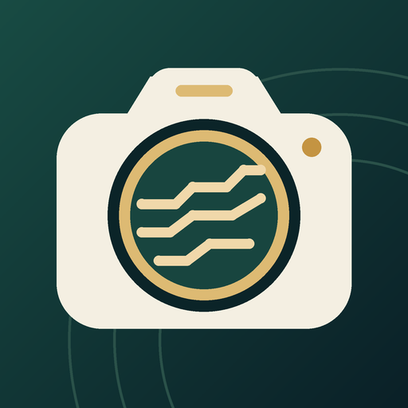

<p align="center">
  
</p>

# 유구한컷 · YuguHancut

**유구의 기록을, 한 컷에.**

고고학 현장에서 사진을 찍는 순간, 유적·유구·촬영 항목과 번호를 함께 기록하는 Android 카메라 앱입니다.


이 저장소는 프로젝트 소개·사용 안내·사용자 피드백을 위한 공개 공간입니다. 앱 소스 코드는 별도로 비공개 관리합니다.

**문서 기준 버전 1.1.3** · **Android 8.0 이상** · **로그인·광고 없음**

[기능 안내](docs/features.md) · [기기 검증](docs/testing.md) · [업데이트 기록](docs/release-notes.md) · [개인정보처리방침](docs/privacy-policy.ko.md)

## 왜 만들었나요?

현장 사진은 촬영 후에도 어느 유구의 어떤 조사 단계인지 구분할 수 있어야 합니다. 사진을 나중에 다시 분류하는 부담을 줄이기 위해, 촬영과 파일명 정리·사진 현황 확인을 한 흐름으로 묶었습니다.

## 촬영에서 기록까지

1. **유적·유구 입력** — 촬영할 현장과 유구 이름을 정합니다.
2. **항목 선택** — 조사전·토층·조사중·조사후 또는 직접 만든 항목을 고릅니다.
3. **촬영·자동 번호** — 같은 유적·유구의 사진에 연속 번호를 붙여 저장합니다.
4. **기록 확인** — 남아 있는 사진의 수를 확인하고 메모·분류 정정·내보내기로 이어갑니다.

```text
현장A--수혈1호 001 조사전 남→북.jpg
```

파일명은 설명용 예시입니다. 방위는 해당 기능을 켰을 때 기록합니다. 조사 단계의 색상은 사진 존재 여부를 나타내며 실제 조사 완료를 판정하지 않습니다.

## 주요 기능

| 기능 | 할 수 있는 일 |
| --- | --- |
| 자동 파일명과 번호 | 유적·유구·촬영 항목을 파일명에 기록하고 사진 삭제 후에도 사용 번호 유지 |
| 사용자 촬영 항목 | 출토유물·내부시설·내부수혈·내부주혈 등 필요한 항목 추가·이름 편집·버튼 숨김 |
| 현장 기록 도구 | 유구별 진행표, 사진 메모, 분류 정정과 변경 이력, 원본·CSV ZIP 내보내기 |
| 같은 구도 재촬영 | 기존 사진을 반투명 참고 화면으로 표시. 새 사진에는 합성하지 않음 |
| 촬영 조절 | 사진·프로·동영상, 전후면, 줌·초점·노출, 기기가 제공하는 제조사 확장 |
| 선택적 방위·위치 | 카메라 방향과 GPS 기록 선택. 기본값은 꺼짐 |

프로 수동 제어·확장 모드·영상 해상도는 기기의 공개 지원 범위에 따라 다릅니다. 삼성 기본 카메라의 모든 기능을 복제한 앱은 아닙니다.

## 설치와 테스트 참여

배포 안내는 [Google Play 앱 페이지](https://play.google.com/store/apps/details?id=kr.namecamera.field)에서 확인합니다. 비공개 테스트 중에는 참여 대상 계정과 배포 지역에 따라 페이지·설치 접근이 제한될 수 있습니다. 이 문서의 버전은 일반 공개 출시나 심사 완료를 뜻하지 않습니다.

소스·개발용 APK·배포 꾸러미는 이 저장소에서 제공하지 않습니다.

## 확인한 기기

| 기기 | 환경 | 1.1.3 확인 범위 |
| --- | --- | --- |
| Galaxy S9 · SM-G960N | Android 10 | 촬영·저장·번호·추가 항목·프로·짧은 FHD 영상·화면 여백 |
| Samsung 폴더블 · SM-F976N | Android 17 | 외부·내부 화면, 전후면·공개 확장, 실제 접기·펼치기와 영상 보존 |

2026-10-21~22 실기기 검사 기준입니다. 테스트 횟수와 확인한 항목·한계는 [기기 검증 요약](docs/testing.md)에 정리했습니다.

## 기술과 정보 처리

Android 네이티브 UI와 Java, CameraX, MediaStore, SQLite를 사용합니다. 촬영·파일명 생성·사진 집계·기록 저장은 기기에서 처리하며 앱 자체의 서버 업로드나 클라우드 동기화 기능은 없습니다.

사용자가 실행한 내보내기·공유나 외부 갤러리·백업 서비스에 따라 사진과 기록이 기기 밖으로 전달될 수 있습니다. 위치를 기록한 사진과 내보내기 자료를 공유하기 전에는 포함 정보를 확인하세요. 자세한 내용은 [개인정보처리방침](docs/privacy-policy.ko.md)을 참고하세요.

## 의견 보내기

[오류 신고](https://github.com/Lithium07z/yugu-hancut-showcase/issues/new?template=bug_report.yml) 또는 [기능 제안](https://github.com/Lithium07z/yugu-hancut-showcase/issues/new?template=feature_request.yml)을 남겨 주세요. 공개 이슈에는 실제 현장명·좌표·연락처·원본 현장 사진을 올리지 마세요.

상단 이미지는 직접 제작한 브랜드 그래픽이며 앱 스크린샷이 아닙니다. 문서 기준일: 2026-10-22.
